# 完整复现手册

目标：为 DJI Osmo Action 4 补充间隔定时录像，自动采集日常 Vlog 片段。安卓 App 负责按计划开始和停止录像；DJI Mimo 继续承担素材查看与导出。复现内容包括页面、交互、连接过程和真机调试闭环。

本手册按留光 · Luma 0.7.1 整理。中文应用名为「留光」，英文名为 Luma，包名为 `local.intervalvlog`。网站提供同版本测试 APK、实际界面图与页面结构参考。新版首页从相机连接区开始，语言支持中文、英文和跟随系统。

## 01 · 给 Agent 的执行约定

把本手册、页面参考图和你的设备信息放到同一个工作目录，让 Agent 先读完，再开始实现。下载的完整 Agent 简报已包含本手册全文。

- 目标设备、功能清单、页面顺序、参数范围和验收表作为实现规格；界面文案和布局对照参考图。
- 每阶段交付可安装 APK、运行命令、测试结果与下一阶段输入。功能失败时，先复现、读日志、定位所属层，再修改。
- 手机操作按「确认前台页面 → 读取控件或截图 → 操作一个目标 → 重新检查状态」执行。重建、旋转或弹窗后重新定位控件。
- 开发过程由 Agent 完成构建、安装、启动、观察、采样日志和回归；手机调试授权、系统权限、相机配对与锁屏口令由设备所有者确认。
- 使用真实相机完成录制与状态验收。页面中的「已连接」「录像已停止」「参数已修改」分别由实际链路、状态和回读驱动。
- 先完成核心控制与定时任务，再加入取景、参数、相册和外观。当前版本的观察操作与定时拍摄采用互斥控制权。

设备输入模板：

```text
电脑操作系统：
工作目录：
开发 Agent 与可用工具：
手机型号 / Android 版本：
adb devices 中选定的设备序列号：
相机准确型号 / 固件版本：
相机当前模式 / SD 卡状态：
UI 参考：本手册的页面参考图
```

## 02 · 成品有多少页面

App 由两个 Activity 组成。MainActivity 承载四个底部导航页面；ObserveActivity 承载三个标签页与全屏取景状态。共有八种主要显示形态，另有 4:3 预览变体、浅色主题和功能弹窗。

| 层级 | 显示形态 | 入口 | 主要职责 |
| --- | --- | --- | --- |
| 主页面 1 | 拍摄 | 启动默认页 / 底栏第一项 | 扫描配对、配置计划、试录、启动和停止任务 |
| 主页面 2 | 相机 | 底栏第二项 | 模式切换、单次拍照、手动录像、设备状态、进入取景器 |
| 主页面 3 | 记录 | 底栏第三项 | 时间顺序事件、复制日志、确认后清空日志 |
| 主页面 4 | 设置 | 底栏第四项 | 语言、主题、后台电池、断开相机、实验室、版本与许可 |
| 观察标签 1 | 画面 | 相机 → 打开取景器 | Wi-Fi 连接、比例适配、构图、参考帧、缩放 |
| 观察标签 2 | 参数 | 取景器 → 参数 | 读取参数、打开选项、修改确认与回读 |
| 观察标签 3 | 相册 | 取景器 → 相册 | 分页列表、缩略图、照片和视频预览 |
| 观察状态 | 横屏全屏 | 画面 → 全屏 | 沉浸式观察、悬浮工具、缩放、返回普通预览 |

### 0.7.1 实际界面对照

以下为本机 0.7.1 中英文 UI 渲染，拍摄与相册功能未在采图期间运行。点按图片可查看原尺寸；记录页使用后面的示例结构图。

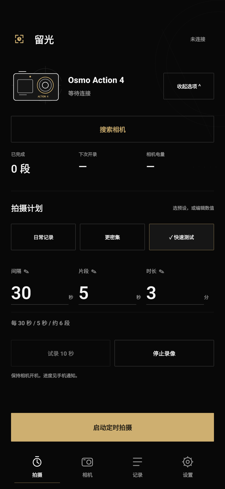
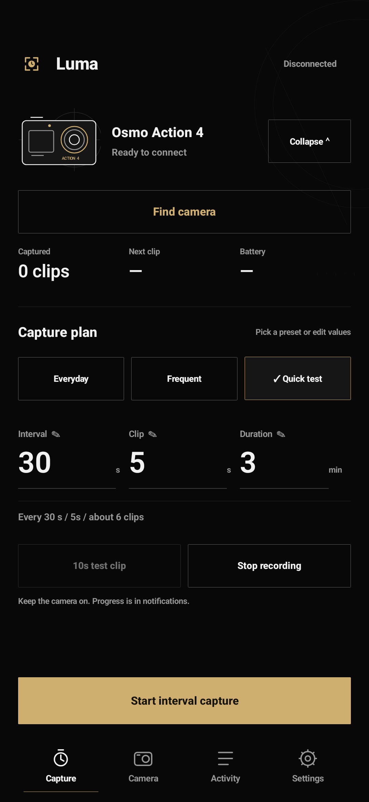
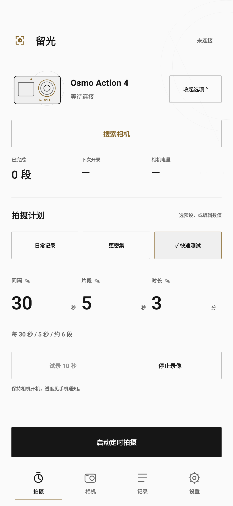
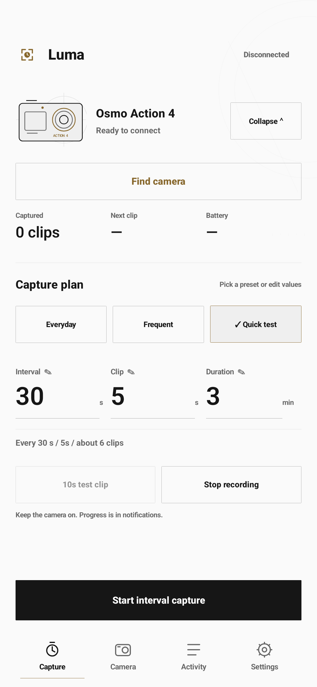
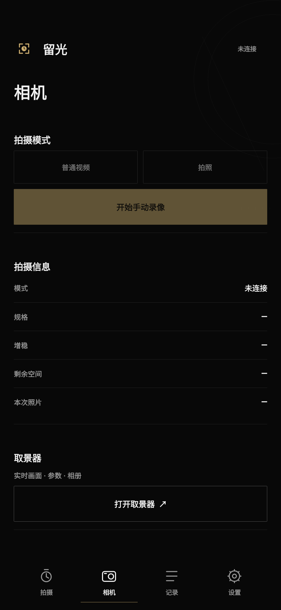
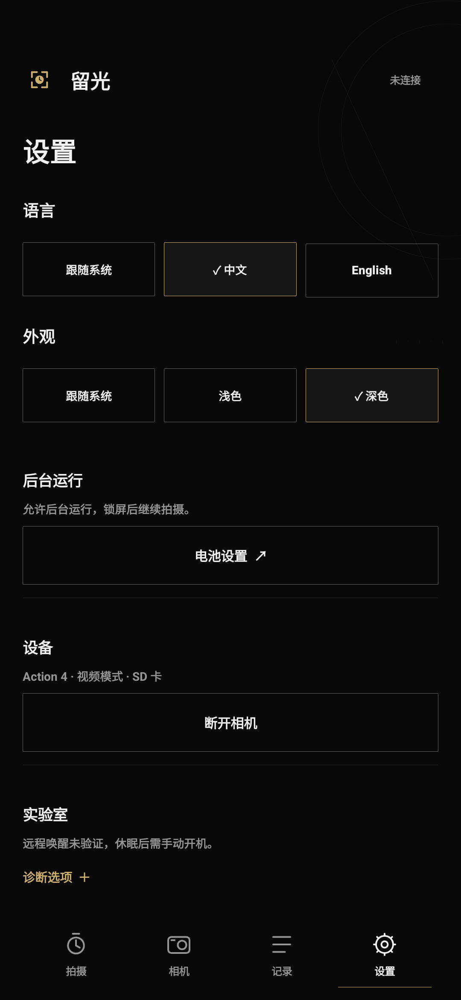
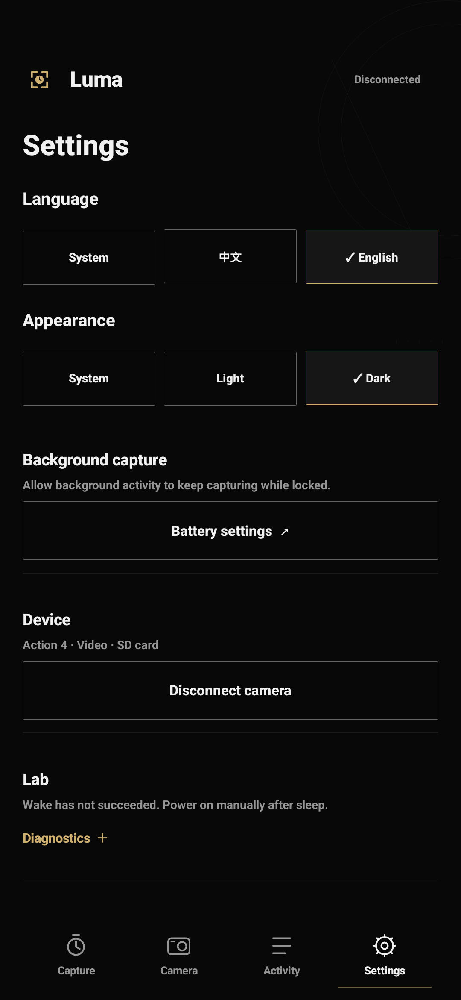
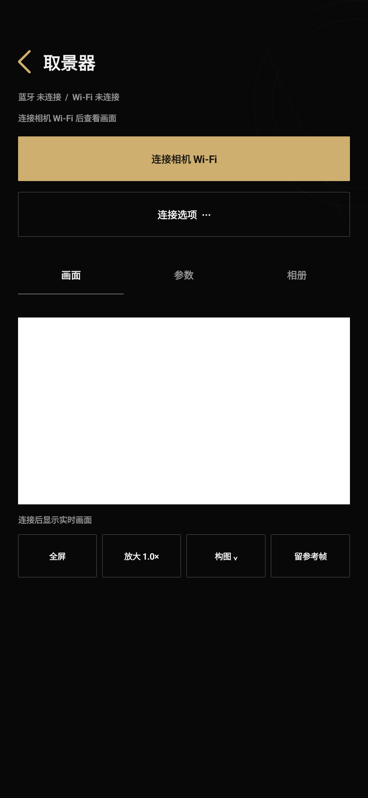
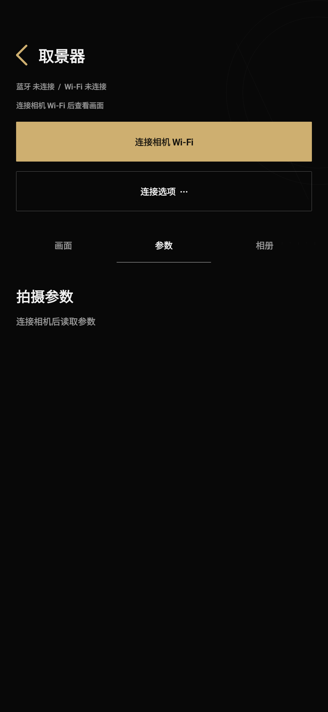
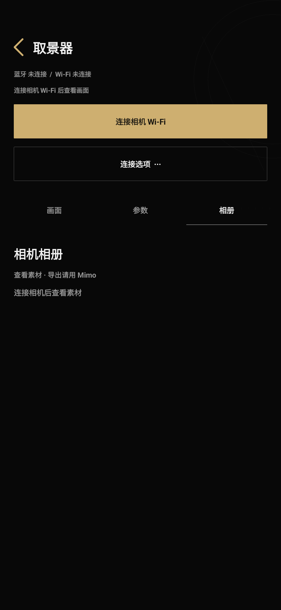
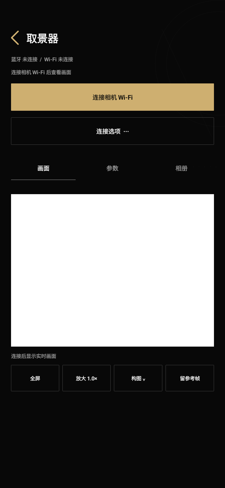
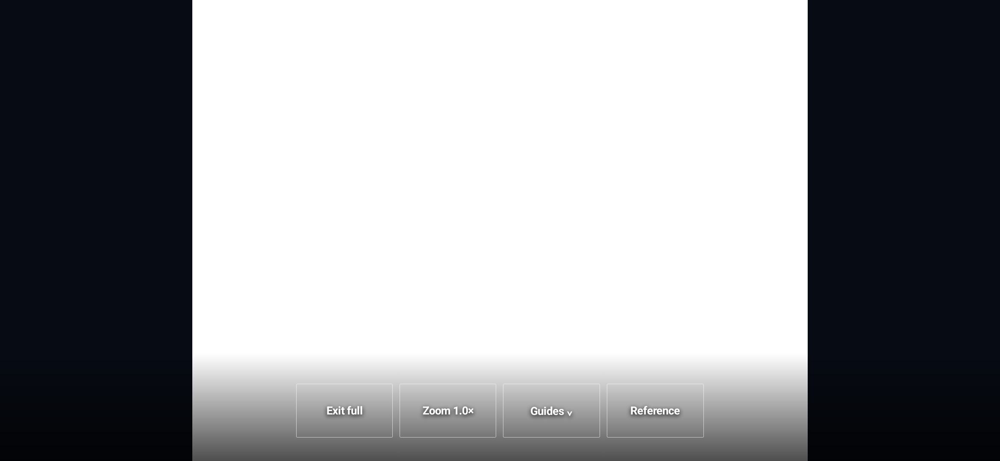

### 页面结构参考

对应参考图：

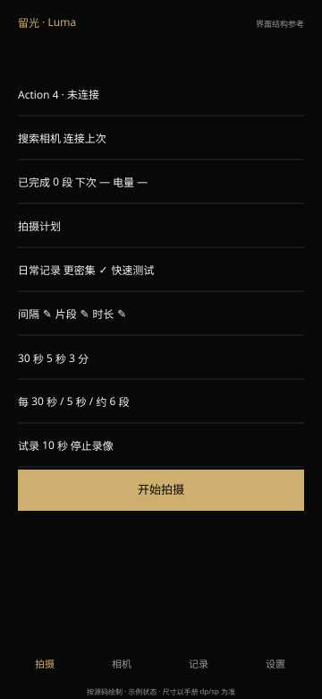
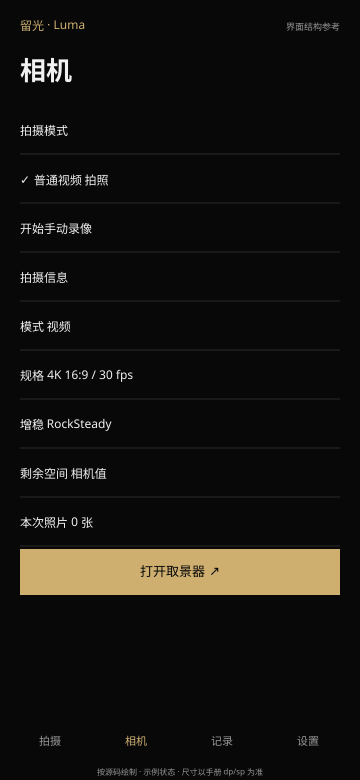
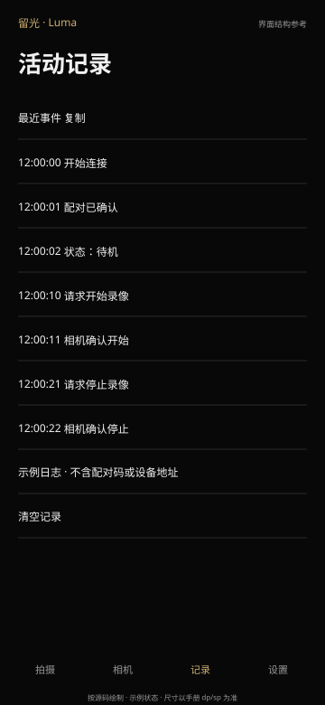
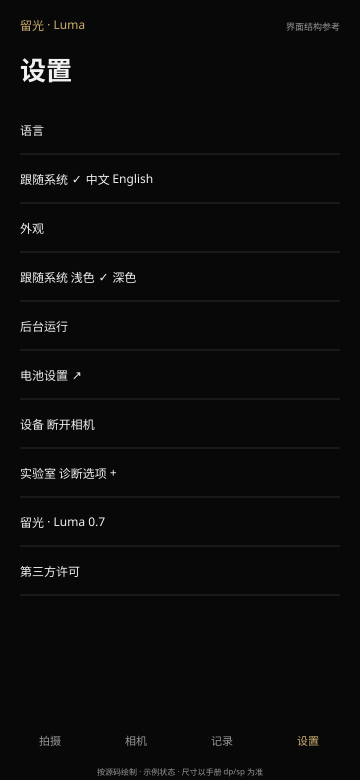
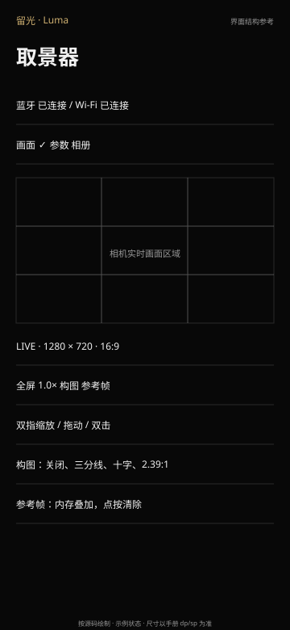
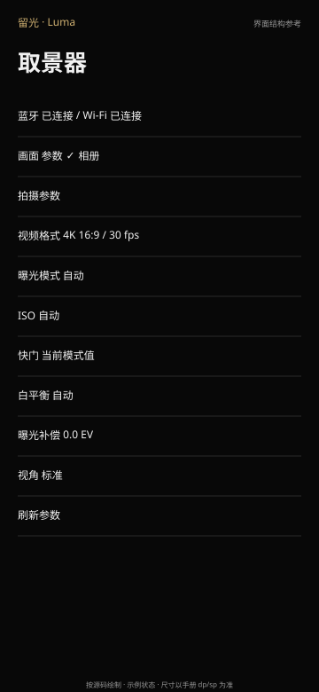
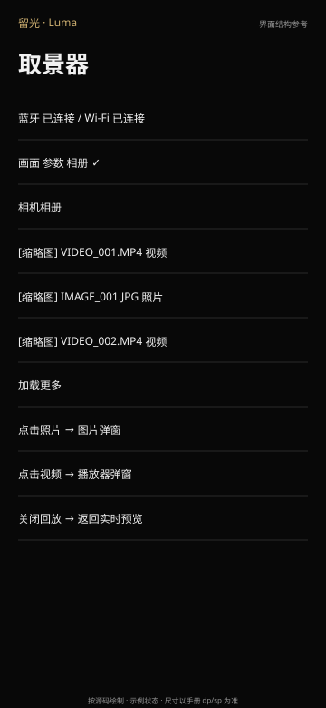
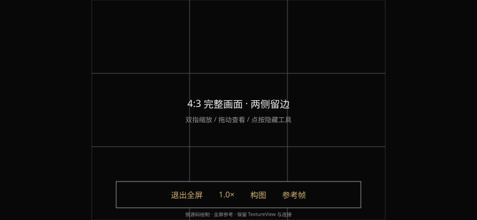

### 拍摄页

从上到下：应用标志与连接状态（品牌为留光 / Luma）；Action 4 线稿、设备名、当前状态、展开/收起连接选项；搜索、连接上次、发现设备列表；已完成片段、下次开录倒计时、相机电量；拍摄计划标题、三组预设；间隔/片段/总时长三个可编辑数字；计划摘要；试录 10 秒、停止录像；底部固定主操作与四项导航。首页不再重复展示「定时拍摄」大标题，相机连接区直接接在应用顶栏之后。

三组预设分别是「日常记录」300 秒 / 10 秒 / 120 分钟，「更密集」180 / 10 / 120，「快速测试」30 / 5 / 3。点击后更新三个输入值、保存草稿、显示选中标记和文字反馈。数字输入带可编辑标识，进入时全选，提交计划后收起键盘。

主按钮按状态显示「开始拍摄」「停止任务」或「停止录像」。运行或等待开停确认时锁定计划输入与模式调整。已完成数只在相机确认结束片段后增加。连接信息可以显式折叠，不能用整块无提示区域代替按钮。

### 相机页

普通视频和拍照为互斥模式，显示当前选中项。切换后等待相机模式状态，随后更新主拍摄按钮：视频模式显示手动录制/停止，照片模式显示拍摄一张。手动录制不继承 10 秒试录期限。

拍摄信息区按统一左标签、右数值展示模式、分辨率/帧率、增稳、剩余空间、本次照片数。取景器入口位于信息区之后；进入条件是相机状态新鲜、处于待机且没有任务或单次拍摄占用。

### 记录页

顶部「活动记录」，下方「最近事件」与复制按钮，再展示可选中的等宽日志。每条包含时间、动作、确认或错误。复制读取当前服务日志；服务不在前台绑定时读取保存的事件文本。清空使用二次确认，只删除 App 日志。

当前实现把日志裁剪到约 10–12 KB，保存在 history/events。用户界面可翻译事件文案，底层协议排错日志保留稳定的标识和数值。

### 设置页

顺序：语言（跟随系统 / 中文 / English）、外观（跟随系统 / 浅色 / 深色）、后台运行和系统电池设置入口、设备与断开相机、实验室的可折叠唤醒/休眠诊断、应用版本和第三方许可。

主题切换先保存计划草稿，再重建页面；语言使用 Android LocaleManager 的应用语言，切换后保留当前设置页、草稿和选中状态。实验室默认收起；休眠测试有确认弹窗。日常拍摄流程不调用休眠。

取景、参数与相册用于开拍前检查和片段观察，详细素材操作仍在 Mimo 中完成。

### 取景器公共区域

返回按钮与标题；独立的「蓝牙 / Wi-Fi」状态行；连接进度与错误；连接 Wi-Fi 按钮及高级连接菜单；画面/参数/相册三个标签。连接成功后收起连接控件，为内容让出空间。高级菜单提供仅蓝牙参数、重新获取 Wi-Fi 信息两个入口。

### 画面与全屏

画面区采用一个持续保留的 TextureView，完整容纳当前画面。其下显示 LIVE、实际解码宽高和显示比例，以及全屏、缩放、构图、参考帧四个工具。双指缩放 1–4 倍，放大后拖动，双击在 1 倍和 2 倍之间切换；按钮也可在 1 倍/2 倍间切换。

构图弹窗提供关闭、三分线、中心十字、2.39:1 遮幅。参考帧截取当前预览到内存，半透明叠加用于机位对齐，按钮改为「清除参考」。比例改变时重置缩放、平移和参考帧。

全屏请求横屏并隐藏系统栏；工具移到画面底部，点击画面切换工具可见性。系统返回键优先退出全屏，再返回上一页。旋转期间保留 Activity、TextureView、输出 Surface 和网络会话，只调整容器与工具位置。

### 参数页

七个条目：视频格式、曝光模式、ISO、快门、白平衡、曝光补偿、视角；底部刷新。读取后显示实际值，当前拍摄模式不支持的条目置灰。参数弹窗显示范围，不把所有理论组合标为已通过硬件验证。

视频格式：4K / 2.7K / 1080P 的 16:9，4K / 2.7K 的 4:3；帧率选项 24、25、30、48、50、60 fps。曝光自动/手动；ISO 100–6400；快门 1/25、1/50、1/60、1/100、1/120、1/200、1/250、1/500、1/1000、1/2000；白平衡自动或 3000–7500 K 的列出选项；补偿 −2、−1、0、+1、+2 EV；视角超广、广角、标准、自然广角。相机拒绝某组合时显示原错误并重新读取。

### 相册与弹窗

从相机读取分页媒体列表，显示缩略图、文件信息和加载更多。照片点击打开图片预览；视频优先请求低码率 .LRF 代理，失败后尝试原 MP4，播放器提供播放控制。关闭弹窗停止播放。退出相册返回实时画面时等待相机结束回放，再恢复预览。

弹窗清单还包括：模式相关的参数选择、构图设置、清空日志、实验室休眠确认、许可文本。详细下载与导出继续使用 DJI Mimo。

## 03 · 外观与复刻尺寸

深色：背景 #080808，正文 #F1F1F1，次要文字 #969696，强调金 #CEAF70，分隔 #292929。浅色：背景 #FAFAFA，正文 #161616，次要文字 #686868，强调 #87672C，分隔 #E1E1E1。深色为默认，另保留浅色和跟随系统。

| 部位 | 规格 |
| --- | --- |
| 页面内容边距 | 20 dp；左右对齐一致 |
| 顶栏 | 68 dp，图标 30 dp，品牌 21 sp |
| 页面标题 | 28 sp，sans-serif-medium |
| 普通正文 / 辅助信息 | 12–14 sp / 10–12 sp |
| 计划大数字 | 当前源码 36 sp，sans-serif-light，等宽数字特性 |
| 主按钮 | 高 52 dp，深色金底深字；固定在底栏上方 |
| 次级按钮 | 通常高 48 dp，细轮廓、点击 ripple |
| 底部导航 | 高 68 dp，图标约 23 dp，文字 11 sp |
| 选中反馈 | 勾选、边线、明确的已选中状态；不只改变颜色 |
| 表面 | 单色底、细分隔线、近直角；相机示意线稿 |

页面参考包含浅色和深色版本。尺寸使用 dp/sp，适配系统栏 Insets、键盘和文字换行。预览全屏是横向布局，不把竖屏内容缩小塞进横屏。

## 04 · 技术栈与模块边界

| 模块 | 当前实现 | 负责内容 |
| --- | --- | --- |
| MainActivity | Java / 原生 Android View | 四页 UI、输入、草稿、服务绑定与渲染 |
| CameraService | Foreground Service、Binder、Handler | 单一拍摄状态源、BLE、调度、通知、唤醒锁 |
| Protocol / Advertisement | 纯 Java | R SDK 封装与流式解析、广播候选识别 |
| ObserveActivity / MimoLink / Duml | Java / BLE 与原生网络 API | 观察会话、Wi-Fi 配置、DUML 参数操作 |
| LiveBackend / DumlTransport | Kotlin | UDP 会话、心跳、可靠控制窗口、视频单元重组 |
| MediaBackend | Kotlin / 共享传输会话 | 相册、相机媒体访问、回放交接 |
| PreviewDecoder | MediaCodec / HEVC | H.265 解码，输出尺寸、裁剪和像素宽高比 |
| PreviewViewport / PreviewGeometry | TextureView / Canvas / 纯 Java | contain 比例、全屏、手势、构图、参考帧 |
| Visual | 原生 Drawable / Canvas | 配色、控件状态、线稿图标 |
| I18n | Android resources / LocaleManager | 中英文本、应用名、通知、语言切换 |

包名 `local.intervalvlog`；最低 Android 13/API 33，target API 35。主入口 `.MainActivity` exported；相机服务、取景器不对外 exported。语言变体不更换包名。

当前本地构建使用 Corretto JDK 21、Android API 35、build-tools 35.0.0、Kotlin 2.1.21、D8/R8 8.10.21。流程是 javac/kotlinc → D8 → aapt2 → zipalign → apksigner，不依赖 Gradle。观众的 Agent 可以选择标准 Android 构建工程，但最终包名、权限、页面与功能验收应一致；工具链路径按观众电脑安装位置配置。

权限包括附近设备扫描/连接、实验广播、通知、INTERNET、网络状态、Wi-Fi 状态/修改、NEARBY_WIFI_DEVICES、前台服务及 connectedDevice 类型、WAKE_LOCK、电池优化豁免请求。BLE 扫描声明 neverForLocation。这里控制外部相机，不调用手机摄像头。权限请求和 Wi-Fi 连接保留 Android 系统确认。

系统接口依据：[ADB 官方文档](https://developer.android.com/tools/adb)、[蓝牙权限](https://developer.android.com/develop/connectivity/bluetooth/bt-permissions)、[connectedDevice 前台服务](https://developer.android.com/develop/background-work/services/fgs/service-types#connected-device)。

## 05 · 准备电脑与手机调试环境

原始验证环境是 Mac、Samsung S25 FE SM-S731B/DS（Android 17 / One UI 9）和 Action 4。复现时记录自己的设备和固件信息。

1. 安装 Codex 或可执行终端、读取文件和调用设备工具的 Agent；提供独立项目目录。
2. 安装 Android Platform Tools、JDK、Android SDK、build-tools 和所选 Kotlin/构建工具，执行 adb version 与 java -version 核对可执行文件。
3. 三星：设置 → 关于手机 → 软件信息，连续点击版本号七次；开发者选项 → USB 调试。
4. 数据线连接电脑与手机，在手机上确认此电脑的调试授权。多设备时先选定 serial，之后每条命令带 -s。
5. 相机开机、插 SD 卡、普通视频待机、退出 Webcam；完成 Mimo 官方激活后关闭 Mimo。
6. 新项目创建 README、spec、decisions、evidence 目录，记录规格、路线选择和每阶段日志。

```sh
adb version
java -version
adb devices -l
# 把 YOUR_PHONE_SERIAL 替换为 adb devices 显示的目标设备
adb -s YOUR_PHONE_SERIAL shell getprop ro.product.model
adb -s YOUR_PHONE_SERIAL shell getprop ro.build.version.release
adb -s YOUR_PHONE_SERIAL shell wm size
```

device 表示可调试；unauthorized 表示需要手机确认；offline 先重新插线并检查 USB 模式；列表为空时检查是否为数据线。设备序列号留在本机记录。

## 06 · Agent 如何操作和观察手机

### 安装、点亮并启动

由 Agent 构建 APK 后执行下面的开发命令。这里的 APK_PATH 和 serial 由 Agent 根据实际路径填写。

```sh
adb -s YOUR_PHONE_SERIAL install -r APK_PATH
adb -s YOUR_PHONE_SERIAL shell input keyevent KEYCODE_WAKEUP
adb -s YOUR_PHONE_SERIAL shell am start -W -n local.intervalvlog/.MainActivity
adb -s YOUR_PHONE_SERIAL shell dumpsys window windows
```

-W 等待启动结果；检查 dumpsys 中的当前焦点确实属于本 App。屏幕有 PIN、密码或生物识别锁时，让用户解锁，再继续前台操作。日常调试用 install -r 保留配对和草稿；签名不匹配时先报告错误，选择新包名或经用户确认后处理旧安装，避免直接清除数据。

### 看清控件再操作

使用 Agent 已配置的手机控制工具、UIAutomator 或开发期 ADB 操作本 App。每次 UI 重建后获取新的控件树；坐标点击从当前截图或控件 bounds 计算。

```sh
# 当前前台为本 App 时，读取当前控件并截图
adb -s YOUR_PHONE_SERIAL shell uiautomator dump /sdcard/interval-window.xml
adb -s YOUR_PHONE_SERIAL pull /sdcard/interval-window.xml evidence/window.xml
adb -s YOUR_PHONE_SERIAL shell screencap -p /sdcard/interval-screen.png
adb -s YOUR_PHONE_SERIAL pull /sdcard/interval-screen.png evidence/screen.png
# X Y 是当前目标按钮 bounds 的中心，不是固定坐标
adb -s YOUR_PHONE_SERIAL shell input tap X Y
# 修改已聚焦的数字输入；先确认旧值已选中或清空
adb -s YOUR_PHONE_SERIAL shell input text 30
adb -s YOUR_PHONE_SERIAL shell input keyevent KEYCODE_BACK
```

优先按 text、content-desc、可访问性角色与 resource-id 定位控件。自绘 Canvas 区域可通过截图操作；可交互控件应提供内容描述。出现系统权限、Wi-Fi 连接或相机配对提示时，处理当前提示后重新读取 App 状态。

只为前台 App 的 UI 测试临时保持亮屏，结束后移除；长期任务另做锁屏验证。把手机放在桌上等候十分钟后，先核对是否已锁屏，再解释黑屏或没有渲染的问题。

### 连续监控与故障采样

在第二个终端持续读取本 App 日志，保留从操作前到确认后的完整窗口。pidof 可能在进程未启动或已退出时返回空值；先检查，再使用 --pid。

```sh
adb -s YOUR_PHONE_SERIAL shell pidof local.intervalvlog
# 将上一步单个有效 PID 填入 APP_PID
adb -s YOUR_PHONE_SERIAL logcat --pid=APP_PID -v threadtime
# 排查相机状态与协议事件
adb -s YOUR_PHONE_SERIAL logcat -s IntervalVlog:I '*:S'
# 在异常刚出现时检查服务与前台状态
adb -s YOUR_PHONE_SERIAL shell dumpsys activity services local.intervalvlog
adb -s YOUR_PHONE_SERIAL shell dumpsys power
```

App 崩溃重启后重新取 PID；读取崩溃栈时保留本 App 对应的进程段。Wi-Fi 画面故障记录四层数据：网络已获得、完整视频单元数量、解码帧数、Surface 实际显示。分别记录 UDP 收包、解码与 Surface 显示结果。

一次调试记录包含：构建版本、相机模式、操作起点、控件/截图、请求序列号、相机 ACK/状态、结果、恢复动作。SSID 密码、配对身份、私人画面留在本机，不写入公开排错记录。

## 07 · 蓝牙控制协议与连接状态

使用 [DJI 官方 Osmo-GPS-Controller-Demo](https://github.com/dji-sdk/Osmo-GPS-Controller-Demo) 的 R SDK 作为控制起点，辅助协议参考 [Osmosis](https://github.com/KonradIT/osmosis) 与 [Osmo Client](https://github.com/luisreysan/osmo-client)。移植时核对上游版本和许可证。

### BLE 链路

- 服务 FFF0，通知特征 FFF4，写特征 FFF5；均使用标准蓝牙 UUID 扩展形式。
- 先发现服务、开启通知和 CCCD，再发配对帧。写队列按协商 MTU 减 3 分片，按顺序提交，等待写回调后继续。
- 扫描识别 DJI 广播制造商特征，名称用于候选显示；最终配对响应中的设备类型必须是 0xFF33（本机 Action 4）。相机自定义名称不影响这个型号判定。
- 每个安装生成并保存稳定控制器身份，重连复用。配对显示验证码，用户在相机确认；拒绝后停止，成功后订阅状态。
- R SDK 帧以 AA 开头，包含长度、类型、序列号、头 CRC16、命令集/ID、payload、尾 CRC32。解析器处理通知分片、粘包、坏帧与重新同步。

| 命令 | 用途 | 结果来源 |
| --- | --- | --- |
| 00/19 | 配对 | 配对事件与用户确认、设备类型 |
| 1D/05 | 状态订阅 | 周期状态 1D/02 |
| 1D/03 | 开始/停止录制或拍照 | 匹配 ACK + 拍摄状态 |
| 1D/04 | 切换模式 | ACK 与后续模式字段 |

本机开停 payload 为 9 字节：前 4 字节 little-endian 0xFF33，第 5 字节 0 表示开始、1 表示停止，其余为保留值。视频模式 1，拍照模式 5；录像状态 3，待机状态为 0 或 1。配对完成后立即订阅，状态包含模式、录像状态、分辨率、帧率、增稳、空间、电量等。

### 就绪和控制权

蓝牙 GATT 连接、配对成功、状态新鲜是三个阶段。当前 fresh 条件是 ready、未休眠、距离最后相机状态小于 5 秒。只有新鲜待机状态允许开始任务或修改配置。

当前服务中的关键状态：running（间隔任务）、pendingStart、owned（本 App 已确认开录）、pendingStop、stopAck、pendingPhoto、pendingMode、auxiliaryActive、sleeping。UI 绑定这些状态，不另维护一套独立的「看起来已录制」计时器。

## 08 · 定时任务状态机

约定：间隔是两次开录开始时间之差。首次片段立即请求，后续目标点沿计划时间轴推进。忙碌或断连跨过目标点时跳到下一个有效目标点，不连发补拍。

```text
待机 → 请求开始(pendingStart) → 状态=录像中(owned)
     → 到达 recordUntil → 请求停止(pendingStop)
     → 匹配 stop ACK + 状态回待机 → 完成数 +1
     → 等待下一目标点 / 到达总时长退出
```

| 项目 | 当前规则 |
| --- | --- |
| 间隔 | 30–3600 秒 |
| 单段 | 1–60 秒 |
| 总时长 | 1–720 分钟 |
| 余量 | 间隔至少比片段长 10 秒 |
| 调度时钟 | SystemClock.elapsedRealtime，当前 tick 约 250 ms |
| 片段停止起点 | 相机确认开录状态之后的 clipMs |
| 试录 | 独立 10 秒期限，running=false 也检查停止 |
| 手动录像 | recordUntil=Long.MAX_VALUE，直到用户停止 |
| 停止确认 | 匹配命令序列号、成功 ACK、相机返回待机 |
| 停止重试 | 已就绪且等待停止超过 5 秒，重发停止请求 |
| 过渡超时 | 开始 10 秒、模式 8 秒、照片 15 秒后给出结果 |
| 重连 | 有任务或拍摄过渡时，断链约每 10 秒尝试恢复 |
| 任务结束 | 到总时长、用户结束、温度异常或电量 ≤5% 时结束，并处理正在录制的片段 |

使用 connectedDevice 前台服务、持续通知和 PARTIAL_WAKE_LOCK。通知能打开 App 和停止任务。启动任务前核对电池优化豁免，按手机品牌完成后台设置。服务使用 START_NOT_STICKY，进程被系统结束后不自动恢复旧计划。

拍照采用「请求被接受 → 观察到拍摄状态 → 回到待机」计数；只收到 ACK 不算完成照片。任务、单次拍摄、参数调整和观察页面统一申请控制权。

## 09 · Wi-Fi、取景和相册如何交接

### 首次连接与再次连接

首次获取 Wi-Fi 信息时，用辅助 Mimo BLE 配对，申请相机 SSID/密码，再交给 WifiNetworkSpecifier 请求相机网络。系统确认获得网络后，将本 App 的网络请求绑定到相机网络；本机 AP 为 192.168.2.1。该请求不要求 INTERNET capability，App 本身仍需 INTERNET 权限以使用本地 socket。

SSID/密码和相机地址的对应关系存在 App 私有偏好中。正常再次取景直接使用同一相机的缓存凭据，保留拍摄用 R SDK BLE；凭据变化时使用高级菜单重新获取。Wi-Fi 成功后关闭辅助 provisioning BLE，必要时恢复拍摄 BLE。状态行分别显示两条链路。

退出取景器时释放网络绑定和请求、结束自己的观察会话；用 generation/lease 标识检查清理归属，避免旧页面延迟回调干扰新连接。已有的拍摄 BLE 保留。蓝牙与 Wi-Fi 可同时工作；App 的「任务/观察互斥」是控制策略。

### 视频和 UDP

相机 Wi-Fi 上使用注册过的 DUML/UDP 会话，持续心跳与确认窗口；本机使用 UDP 9004，配对/注册过程还涉及 TCP 7001。视频先重组成完整访问单元，再送入容量有上限的队列；MediaCodec 在后台解码 H.265，Surface 显示画面。

可靠控制包维护最多 256 项 outbox，未确认约 300 ms 后按原序列重发；控制、视频和下载分别跟随相机接受游标。ACK 在接收循环中按约 25 ms 的预算持续发送，避免阻塞读使视频窗口停止前进。序列号回绕和未知 ACK 要有回归测试。

### 画面比例

本机 Action 4 在 16:9 和 4:3 拍摄配置下都可能给出 1280×720 的 HEVC 预览。显示比例先读拍摄状态/格式：分辨率编码 95、103 为 4:3；10、16、45 为 16:9。优先复用 BLE 状态，状态不可用时才按约 2.5 秒间隔通过 Wi-Fi 回读 02/19。未知格式回退到解码尺寸、crop 和 SAR。

布局采用 contain：缩放整个画面到容器内部，保留空边；放大后按图像和视口尺寸约束平移。参数格式改变后更新比例并清除旧参考帧。预览缩放与相机的 FOV 参数分开。

### 参数确认与相册

视频格式读 02/19、写 02/18；曝光读 02/1F、写 02/1E；ISO 02/2B、02/2A；快门 02/29、02/28；白平衡 02/2D、02/2C；补偿 02/2F、02/2E；视角用 02/8E。顺序是读取、用户选择、写 ACK、短等待、读回比对、刷新 UI。

LiveBackend 与 MediaBackend 交接同一个注册传输会话，交接前停止旧读线程；不能同时由两个 socket 抢读同一逻辑会话。相册播放结束后释放回放 presence，并等待 02/80 中的回放标记清除，再启动实时画面。HTTP 媒体路径限制在相机 DCIM/MISC 等需要的位置，读取量和内存分配设上限。

## 10 · 分阶段让 Agent 实现

### 阶段 A：环境与 UI 骨架

```text
先完成环境盘点、可复现构建脚本、包名与权限清单。实现四个主页面及观察 Activity 的三个标签，按参考图布局；设备区显示真实未连接状态。安装并逐页检查点击、输入、底栏、安全区和主题。提交页面截图、构建命令和页面清单，再进入蓝牙阶段。
```

### 阶段 B：BLE 与单次拍摄

```text
阅读 DJI 官方 R SDK 示例，实现广播识别、服务发现、通知、串行分片写、配对、型号校验和状态订阅。处理自定义名称。先让 App 真实显示新鲜待机状态；再做 10 秒试录、手动录制和单张照片。每项采集请求、序列号、ACK、状态和 SD 卡结果。10 秒后停止与手动持续录制必须分别验证。
```

### 阶段 C：调度与后台

```text
把拍摄状态集中到 CameraService，按第 08 节实现状态机、参数校验、通知、后台电池前提、停止重试和超时。先做 30/5/3 快速计划，逐段核验；然后重复锁屏和后台测试。保存证据后继续观察功能。
```

### 阶段 D：Wi-Fi 与辅助功能

```text
从首页已连接 BLE 的实际路径进入观察，完成 Wi-Fi 首次配置与缓存重连。显示独立 BLE/Wi-Fi 状态。按网络、视频单元、解码和显示四层检查。加入参数 ACK+回读、只读相册、照片/视频弹窗和返回直播；测试中恢复修改的相机参数。
```

### 阶段 E：比例、全屏和外观

```text
实现相机拍摄格式与解码尺寸共同决定显示比例，实测 16:9/4:3。横屏时保留同一 TextureView、Surface 和连接。加入缩放平移、构图和参考帧；按黑金视觉规范完成全部页面，再检查浅色、深色、语言切换与选中反馈。
```

### 阶段 F：交付与复测

```text
运行逻辑测试、UI 仪器测试和硬件观察路径。记录 APK 版本与 SHA-256。交付构建说明、安装与配对步骤、验收表和第三方许可。把每个失败、原因和对应修复写入 decisions 与 evidence，便于下一次 Agent 接续。
```

## 11 · 开发中遇到的问题与修复

| 现象 | 本项目查到的原因或证据 | 实现处理 | 回归方法 |
| --- | --- | --- | --- |
| 拔卡后 USB 只能选 Webcam | Webcam 是视频输入模式，与相机 SD 录制控制目标不同 | 手机运行定时拍摄工具；相机装卡、普通视频待机 | 无电脑连接相机时仍可由手机开始/停止拍摄 |
| 固件能下载和拆包，但没有改成功 | 固件容器涉及加密与签名；未获得设备接受自定义固件的完整链路 | 固件分析退出主实现路径，使用已验证的协议控制 | 控制功能通过真机验证，不依赖刷写 |
| 相机被改名后扫描不到 | 只匹配固定名称遗漏候选 | 制造商广播识别候选；配对再校验设备类型 | 默认名、改名、无名候选、无关设备分别测试 |
| 10 秒试录一直不停 | 停止判断曾依附于间隔任务 running；试录没有该标记 | owned 的停止期限独立检查 | 试录约 10 秒确认停止，手动录像继续录到用户停止 |
| 软件显示停止，但相机仍录像 | 发送停止和倒计时结束都不是相机已停止的证据 | 匹配 stop ACK 与待机状态，等待时显示处理中 | 匹配/错序 ACK、超时、真实相机停止都检查 |
| iPhone 定期开 Mimo 的思路无法覆盖需求 | 交互自动化与稳定的后台相机控制是不同工作条件 | 采用安卓原生服务和无线协议 | App 离开前台与锁屏后分别观察任务 |
| 手机提示唤醒广播成功，相机仍黑屏 | 系统接受广播只证明手机发出请求；多轮相机验证无开机结果 | 唤醒留在实验室；定时任务保持相机开机 | 同时观察亮屏/声音/新状态，不能把广播回调当开机 |
| BLE 已连接，进 Wi-Fi 却报 07/45 | warm path 重新走辅助配对超时；冷启动直进取景器没覆盖该路径 | 相机绑定的缓存凭据；首次暂让出 BLE，有限次数重试，仅重试就绪超时 | 首页先 BLE → Wi-Fi → 返回，连续两轮检查两条链路 |
| 连接 Wi-Fi 后 BLE 消失 | provisioning BLE、拍摄 BLE 的角色被混淆或释放顺序错误 | Wi-Fi 接管后关闭辅助配置链路，保留/恢复 R SDK | 预览期间仍接收新鲜拍摄状态，返回首页可控 |
| 相册有数据但返回预览卡住 | 回放 presence 未释放、会话被重新注册或并发读取 | 同一 transport 交接、停旧读线程、等待回放标记清除 | 照片/视频 → 关闭 → 返回画面，继续实际解码 |
| 数据收到 23 帧左右后停止 | UDP 可靠窗口与确认游标不前进 | 原序重发、三类游标、接收中持续 ACK | 丢包、乱序/未知 ACK、16 位回绕，以及持续真机预览 |
| 4:3 在手机上变形 | 录制为 4:3 时预览 carrier 仍为 1280×720 | 拍摄格式决定显示比例，解码宽高作为回退 | 真机切 16:9/4:3，分别看普通/全屏并恢复原参数 |
| 手机锁屏使黑屏被误判成解码失败 | 已收到并解码，但显示条件不成立 | 监控电源/前台状态；观察页临时 KEEP_SCREEN_ON | 将网络、解码、Surface 和屏幕状态分别记录 |
| 全屏重建 UI 后断流 | 重建或移动 TextureView 导致 Surface 更换 | configChanges + 持续 TextureView，只移动工具条 | 全屏前后会话身份与帧数持续增长 |
| 桌面 Logo 看成纯黑 | 图标对比不足及系统主题图标行为需要分开检查 | 独立 adaptive 前景/背景/monochrome；颜色与通知图标分开 | 渲染普通和单色图层，再看真实桌面图标 |
| 极简界面按钮像文字，选中状态不明显 | 控件缺少轮廓、反馈或明确入口 | 次级细框、ripple、预设勾选、输入标识、显式展开按钮 | 真实点击预设和折叠按钮，核对输入值与可见状态 |
| 更换主题或语言后输入/页面丢失 | 重建时只恢复外观，遗漏业务草稿和页索引 | SharedPreferences 保存草稿，实例状态恢复页码，LocaleManager 切换语言 | 中英/系统切换后保持设置页与计划数值 |
| adb run-as 提示 package not debuggable | 发布包未声明 debuggable，私有目录不能用该命令读取 | 常规排错使用本 App logcat、事件页和仪器检查；需要私有状态时在开发构建中提供受控导出 | 安装发布包后也能完成状态、日志和页面验收 |
| adb pull 后看到了旧版截图 | 目标目录已存在时可能再嵌套一层同名目录，旧文件仍留在原层级 | 每轮拉到新的版本/批次目录，核对实际路径、时间和构建版本 | 修改一个可见标签后重新采集，确认查看的是最新图 |

排错时保留三项：原始可复现操作、修复对应的状态或协议条件、能够再次运行的回归检查。上表的未验证路线保留为已知边界，日常流程直接采用已验证路径。

## 12 · 构建、自动检查和证据目录

按下面的模块分工创建工程，文件名也可作为 Agent 实现任务的切分单位。

```text
android/
  AndroidManifest.xml
  build.sh
  src/local/intervalvlog/
    MainActivity.java  CameraService.java  ObserveActivity.java
    Protocol.java     Advertisement.java  MimoLink.java  Duml.java
    PreviewDecoder.java  PreviewViewport.java  PreviewGeometry.java
    Visual.java       I18n.java
    TimingCheck.java  UiCheck.java  HandoffProbe.java
    ObserveProbe.java PreviewCheck.java LocaleCheck.java
  vendor/osmosis/     # 按许可证保留的辅助模块与本地修改
  res/values/ res/values-zh/ res/values-night/ res/xml/
  localization/      # 文案索引
  test/              # 纯 JVM 与资源一致性检查
  THIRD_PARTY_LICENSE.txt
  build/             # APK 和本地签名材料，按发布范围管理
evidence/
  stage-01-environment.md
  stage-02-ble.log
  stage-03-interval.log
  stage-04-wifi.log
  checks/ screenshots/ decisions/
```

复现工程需实现并在 Manifest 注册下面的仪器测试入口。注册后即可执行这些命令；每项断言见表。

```sh
bash android/build.sh
adb -s YOUR_PHONE_SERIAL install -r android/build/interval-vlog-test.apk
adb -s YOUR_PHONE_SERIAL shell am instrument -w local.intervalvlog/.TimingCheck
adb -s YOUR_PHONE_SERIAL shell am instrument -w local.intervalvlog/.UiCheck
# 以下需要相机开机、装卡、待机，手机解锁；系统 Wi-Fi 提示需确认
adb -s YOUR_PHONE_SERIAL shell am instrument -w local.intervalvlog/.HandoffProbe
adb -s YOUR_PHONE_SERIAL shell am instrument -w -e warm_start true local.intervalvlog/.ObserveProbe
adb -s YOUR_PHONE_SERIAL shell am instrument -w local.intervalvlog/.PreviewCheck
# 0.7 语言实现后加入
adb -s YOUR_PHONE_SERIAL shell am instrument -w local.intervalvlog/.LocaleCheck
```

| 检查 | Agent 需要实现的断言 |
| --- | --- |
| ProtocolTest / PreviewGeometryTest | 官方 CRC 向量、分片坏帧恢复；4:3/16:9 contain、SAR、缩放边界和格式映射 |
| ReferenceCheck | 捕获的 6/45 项媒体样本；UDP 原序重发、未知 ACK、序列号回绕 |
| TimingCheck | 试录停止期限、手动持续录制、照片过渡、观察/配置互斥 |
| UiCheck | 四主页面、三标签页、4:3 变体、全屏，两个主题共 18 个状态；真实点击预设和展开按钮 |
| HandoffProbe | 首页 BLE 已就绪开始，取景/返回两轮；预览与返回时拍摄 BLE 都新鲜 |
| ObserveProbe | 实际视频单元与解码、参数读取/FOV 恢复、相册/缩略图/照片/视频、返回直播 |
| PreviewCheck | 16:9/4:3 参数确认、持续渲染、横屏比例、缩放和参考帧；finally 恢复原视频参数 |
| LocaleCheck | 中/英/系统选择、重建后页码/草稿/选中状态、通知与品牌语言 |

手机截图与 UI 渲染分开记录。native View.draw 的布局图证明排版，不自动证明 TextureView 已显示相机画面；真实取景用像素截图或实际显示确认。测试结果包括构建哈希与条件，例如屏幕锁定时只能验证横屏布局，就把物理旋转验证单独列出。

## 13 · 最终验收清单

- 四个主页面、三个观察标签和全屏形态完整；控件顺序、选中反馈、数字输入和状态文案符合页面规格。
- 自定义相机名能发现并连接；配对后读到 Action 4 的新鲜待机状态。
- 试录约 10 秒后停止；手动录像独立保持；照片经过拍摄/待机过渡计数。
- 快速 30/5/3 计划逐段记录开始与停止；用户停止或总时长结束后相机回待机。统计值和相机素材核验一致。
- 锁屏和后台测试单独记录；通知可查看进度与停止任务。
- 从首页 BLE 进入 Wi-Fi，预览期间 BLE 状态更新，退出后控制继续可用。
- 16:9/4:3、普通/全屏比例正确，旋转和返回后继续出画面。
- 参数写入经 ACK 与读回确认；测试完成恢复全部原始参数。
- 相册分页、照片和视频可观察，返回实时预览继续渲染。
- 主题/语言切换保存草稿与页面；桌面图标分别检查普通/主题模式。
- APK 可独立安装和配对；开发电脑不是用户日常使用的依赖。
- 交付包包含构建说明、版本、SHA-256、许可、测试条件、结果和排错记录。

## 14 · 当前设备与使用条件

已验证组合是 DJI Osmo Action 4 与 Samsung S25 FE；最低 Android 13。Action 5/6 由当前型号校验拒绝。其他安卓机按本手册逐项验收。

拍摄期间保持相机开机、SD 卡可写、Mimo 关闭。相机自动关机最长 30 分钟，手机自动唤醒未打通；安排任务前检查相机电源设置和实际间隔。观察操作与间隔任务互斥；App 进程结束不自动恢复计划。长时间电量、温度与连接表现按实际使用时长测试。

留光 0.7.1 测试包的安装顺序：安装 → 相机普通视频待机 → 附近设备与通知授权 → 扫描并确认配对 → 允许相机 Wi-Fi 提示 → 设置后台电池 → 先试录和快速计划。相机初次激活与复杂素材导出使用官方 Mimo。
